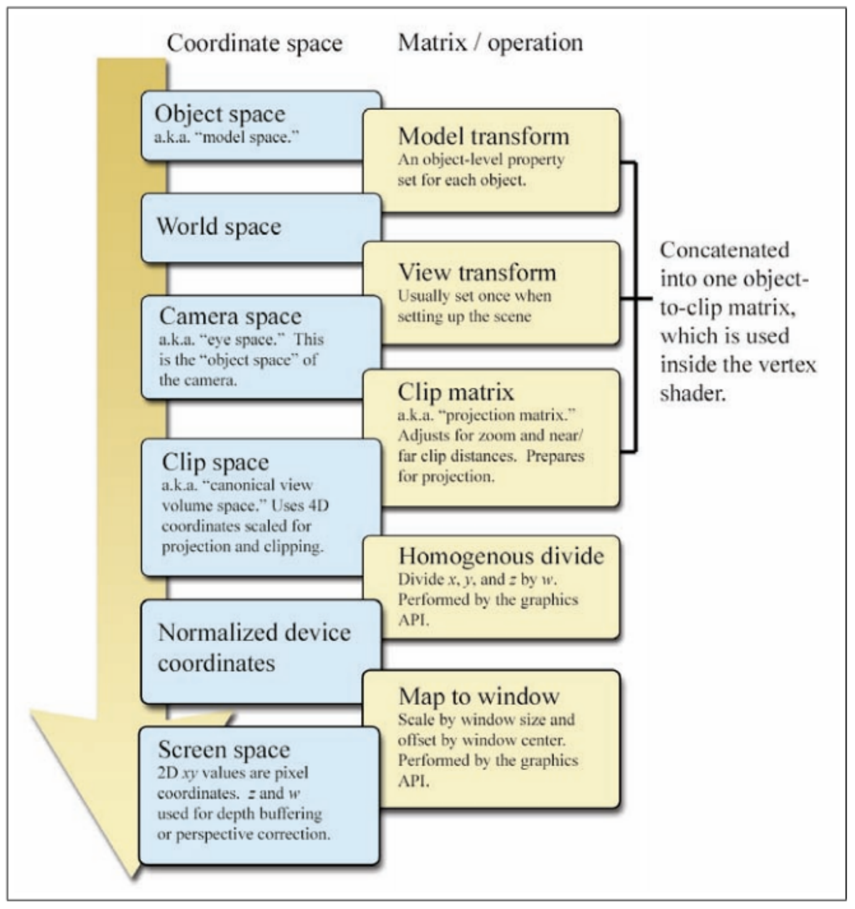

# Specifying the camera

* $\mathbf p_{\text{from}}$
* $\mathbf p_{\text{at}}$
* $\mathbf v_{\text{up}}$

## Building coordinate system

"Gran-Shmidt"

Build the optical axis (Z) first:

```math
\mathbf e_3 = \frac {\mathbf p_{\text{at}} - \mathbf p_{\text{from}}} {\lVert \mathbf p_{\text{at}} - \mathbf p_{\text{from}} \rVert}
```

Then size (X)

```math
\mathbf e_1 = \frac {\mathbf e_3 \times \mathbf v_{\text{up}}} {\lVert \mathbf e_3 \times \mathbf v_{\text{up}} \rVert}
```

Then Y

```math

```


## TODO

# Pipeline

The pipeline we've discussed so far is the world-to-camera transformation: **Translate, Rotate, Project, then Normalize.**

## Culling

When we say "cull", we mean removing objects from the pipeline that are out of view of the camera. These aren't going to land on the image plane anyway, so why spend computations on them? In particular, the very last step in the pipeline requires us to divide by the value in the homo coord, and divisions are pricey.


### Canonical View

The first thing we do is transform from the view frustrum to a "canonical view", a 2x2x2 cube, stretching from $[-1, 1]$ on all axes. This makes it a lot easier to tell if objects are in the camera's view or not.

### Zoom

Changing the camera's focal length affects how big/small an object appears on the viewing plane. We need to keep track of this information when we transform into the canonical view.

```math
\text{zoom} = \frac 1 {\tan(\text{fov}/2)}
```

In other words, zoom is the length from the camera center to where the FOV's width reaches 2.

### Aspect Ratio

The aspect ratio is the ratio of the window dimensions.

The aspect ratio of the window/screen is *inverse* the aspect ratio of the zoom.

```math
AR = \frac {X_{\text{windowdim}}} {Y_{\text{windowdim}}} = \frac {\text{zoom}_y} {\text{zoom}_x}
```

Typically, we only save the FOV's $y$ angle, not its $x$ angle. So we use $\text{FOV}_y$ to find $\text{zoom}_y$ and then use the aspect ratio to derive $\text{zoom}_x$.

### Building the clipping matrix

* Scale visible $x$ to $[-1, 1]$
* Scale visible $y$ to $[-1, 1]$
* Scale $z$ clipping planes $[N, F]$ to $[-1, 1]$
  * $N$: Near clipping plane.
  * $F$: Far clipping plane.

The full matrix is this:

```math
\begin{bmatrix}
\text{zoom}_x & 0 & 0 & 0\\
0 & \text{zoom}_y & 0 & 0\\
0 & 0 & \frac {F+N}{F-N} & \frac{-2NF}{F-N} \\
0 & 0 & 1 & 0
\end{bmatrix}
```

With that transformation, everything *inside* the camera frustrum will be inside that 2x2x2 canonical view cube.

Paris also noted that this matrix includes the perspective projection...supposedly.

### Clipping tests

The rule: any point $[x, y, z, w]^T$ transformed by the clipping matrix falls inside the view frustrum iff its transformed $x'$, $y'$, and $z'$ all fall between $[-w, w]$.

These comparrisons are computationally a lot faster/cheaper than division.

### Culling

- If all a primitive's vertices fail the clip test, that primitive is completely outside the FOV&mdash;so it's thrown out.
- If part of the primitive fails while part of it passes, then we clip specifically the portion in view.
  - That is, we create a new (partial) primitive for the portion that is in view.

## Canonical View &rarr; Screen

We still have one step though&mdash;transforming from camera coords (viewplane) to pixel coords (screen). We already transformed into the canonical view, so we can just transform that directly to the screen.

- Scale $x$ by half the screen's width.
- Invert $y$ and scale by half the screen's height.
- Translate origin from center to upper-left corner of screen.

```math
\begin{bmatrix}
x_\text{screen} \\
y_\text{screen} \\
1
\end{bmatrix} = \begin{bmatrix}
\text{width}/2 & 0 & \text{width}/2 \\
0 & -\text{height}/2 & \text{height}/2 \\
0 & 0 & 1
\end{bmatrix} \begin{bmatrix}
x/w \\
y/w \\ 
1
\end{bmatrix}
```

Note that when it comes to drawing on the screen, we don't need a point's $z$ coord&mdash;so we just dropped it altogether here. 

## Putting it all together


